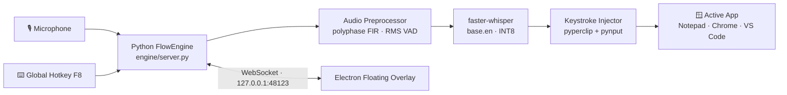

<div align="center">

# 🎙️ FlowVoice

**Local, 100% private voice dictation for Windows — powered by offline Whisper.**

Speak anywhere. Your words are transcribed on-device and typed straight into the app you're already using — no cloud, no accounts, no telemetry.

<br/>

[](#-quick-start)
[](#-tech-stack)
[](#-quick-start)
[](https://github.com/SYSTRAN/faster-whisper)
[](#-privacy)
[](#-license)

[](https://github.com/anesdevv/flow-voice/commits/main)
[](https://github.com/anesdevv/flow-voice/stargazers)

</div>

> [!NOTE]
> FlowVoice is an independent, fully offline voice dictation project. Everything runs locally on your machine — the only network access is the one-time Whisper model download.

---

## 📖 Overview

FlowVoice gives you a transparent floating pill overlay and a global **`F8`** hotkey that turns speech into text anywhere on Windows. Audio is captured at your mic's native sample rate, cleaned with DSP, transcribed by a quantized Whisper model running on your CPU, and pasted into whatever window has focus — while your cursor never leaves it.

```
hold F8  →  speak  →  release  →  text appears, instantly, offline
```

---

## ✨ Highlights

| | Feature | What it does |
|:---:|---|---|
| 🌊 | **Floating pill overlay** | A glassmorphism overlay with a live audio-equalizer waveform that floats above your work. |
| 🎯 | **High-precision `base.en`** | 74M-parameter Whisper model, quantized to INT8 and run locally for strong phoneme accuracy. |
| 🎚️ | **Native audio capture** | Records at your microphone's true hardware rate (44.1/48 kHz), avoiding driver-level aliasing. |
| 🧮 | **Polyphase FIR resampling** | `scipy.signal.resample_poly` with a bandlimited Kaiser window → studio-clean 16 kHz speech. |
| 🤫 | **Adaptive RMS VAD** | Trims dead air and noise-floor before Whisper sees it, killing phantom "thanks for watching" artifacts. |
| 🧩 | **Anti-hallucination decoding** | Beam search (`beam_size=5`), `no_repeat_ngram_size`, and guardrails prevent word loops. |
| ⌨️ | **Hybrid Hold *or* Tap** | Hold `F8` to talk (push-to-talk) **or** tap it to start/stop — your choice, per use. |
| 🪟 | **Zero focus stealing** | `showInactive()` + `focusable:false` keep your blinking cursor exactly where it was. |

---

<details>
<summary><b>🧠 Accuracy &amp; anti-hallucination in detail</b></summary>

<br/>

1. **`base.en` (high precision)** — powered by the 74M-parameter `base.en` model quantized INT8, running entirely on CPU. Far fewer misheard words than `tiny.en`.
2. **Native hardware capture + polyphase FIR** — captured at the device's native rate, then resampled with a bandlimited Kaiser-windowed FIR filter for clean 16 kHz audio.
3. **Adaptive RMS VAD** — estimates the real-time noise floor and discards pure silence/noise so Whisper never invents subtitles.
4. **Anti-hallucination decoding** — `beam_size=5`, `best_of=5`, `condition_on_previous_text=False`, `repetition_penalty=1.1`, `no_repeat_ngram_size=3`.
5. **Hybrid hotkey** — **Hold** `F8` while speaking and release; or **Tap** `F8` to start (*"Listening…"*), speak freely, and tap again to finish.
6. **Smart verbal punctuation** — speak commands like *"comma"* or *"new line"* and they become real punctuation and line breaks.
7. **Zero focus stealing** — the overlay never steals focus, so text lands in Notepad, Chrome, VS Code, or any field you were already in.

</details>

---

## 🏗️ Architecture



| Component | Role |
|---|---|
| **Electron app** | Floating overlay + dashboard; spawns and supervises the Python engine. |
| **Python FlowEngine** | Hosts a WebSocket server on `127.0.0.1:48123` for live UI sync. |
| **Preprocessor** | Native-rate capture, polyphase FIR resampling, RMS VAD silence trimming. |
| **Whisper** | `faster-whisper` (CTranslate2, INT8) transcription with anti-hallucination decoding. |
| **Injector** | Pastes the transcript into the focused window via clipboard + synthetic keystrokes. |

---

## 🧰 Tech Stack

| Layer | Technology |
|---|---|
| Desktop shell | **Electron 44** |
| Speech-to-text | **faster-whisper** (CTranslate2, INT8) |
| Audio capture | **sounddevice** / PortAudio |
| DSP | **NumPy** + **SciPy** (polyphase FIR) |
| Hotkey & injection | **pynput**, **pyperclip**, Win32 via **ctypes** |
| IPC | **WebSocket** (`ws` ↔ `websockets`) |
| Persistence | Local JSON files |

---

## 🚀 Quick Start

### Requirements

- 🪟 **Windows 10/11**
- 🐍 **Python 3.9+** (with `pip`)
- 🟢 **Node.js 18+**
- 🎤 A microphone
- 🌐 Internet **once**, to download the Whisper model on first run

### 1 · Clone & install

```bash
git clone https://github.com/anesdevv/flow-voice.git
cd flow-voice

# JavaScript / Electron dependencies
npm install

# Python speech engine dependencies
pip install -r requirements.txt
```

### 2 · Run

```bash
npm start
```

This launches the Electron overlay + dashboard **and** spawns the Python engine (`python engine/server.py`).

To run the engine by itself (headless):

```bash
npm run engine
# or
python engine/server.py
```

### Commands

| Command | Description |
|---|---|
| `npm start` | Launch the full app (overlay + dashboard + engine). |
| `npm run engine` | Run the Python speech engine standalone. |
| `python engine/server.py` | Same as above, run directly. |

---

## 🎤 Usage

1. Open **Notepad**, click the **YouTube search bar**, or focus **any** text field.
2. Either **hold `F8`** while you speak and release, **or tap `F8`**, speak, and **tap `F8`** again.
3. Say something like: *"Hello world period This is a high accuracy test period"*
4. Your speech is transcribed locally and pasted straight into the input — no focus change, no cloud round-trip.

### 🗣️ Voice commands

| You say | You get |
|---|---|
| *"period"* / *"full stop"* | `.` |
| *"comma"* | `,` |
| *"question mark"* | `?` |
| *"exclamation point"* | `!` |
| *"new line"* / *"next line"* | Line break |
| *"press enter"* / *"hit enter"* | Enter keypress |

---

## 📂 Project Structure

```text
flow-voice/
├── app/                          # Electron desktop app
│   ├── main.js                   # Main process — spawns engine, creates windows
│   ├── preload.js                # Secure IPC bridge
│   ├── overlay.html/css/js       # Floating glassmorphism pill overlay
│   ├── dashboard.html/css/js     # History · Notes · Dictionary · Snippets · Settings
│   └── data_store.js             # Local JSON persistence
├── engine/                       # Python speech engine
│   ├── server.py                 # WebSocket server (127.0.0.1:48123)
│   ├── whisper_engine.py         # faster-whisper model + audio capture
│   ├── audio_preprocessor.py     # Polyphase FIR resampling + RMS VAD
│   ├── hotkey.py                 # Global F8 hotkey (pynput)
│   └── injector.py               # Text injection into the active app
├── data/                         # Local user data (git-ignored)
│   └── *.example.json            # Templates: history, notes, settings, ...
├── package.json
├── requirements.txt              # Python engine dependencies
├── LICENSE
└── README.md
```

> [!TIP]
> Files under `data/` are **your** local data — they're git-ignored. The repo only ships `data/*.example.json` templates, and the app regenerates any missing file with sensible defaults on first run.

---

## 🔒 Privacy

FlowVoice is built around one idea: **your voice never leaves your machine.**

- ✅ Transcription happens **locally** on your CPU — no audio or text is uploaded.
- ✅ No accounts, sign-in, or API keys.
- ✅ No telemetry or analytics.
- ✅ Your dictation history, notes, and snippets stay in local JSON files.
- 🌐 The **only** network request ever made is the one-time download of the Whisper model from Hugging Face.

---

## 📄 License

Released under the **ISC License** — see the [`LICENSE`](LICENSE) file.

<div align="center">

<sub>Built for people who talk faster than they type. 🎙️ → ⌨️</sub>

</div>
